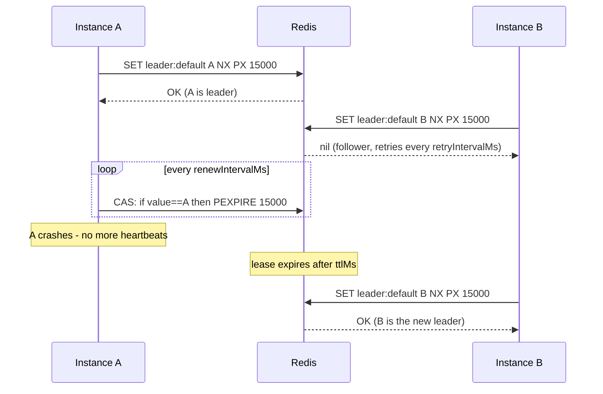

# Core Concepts

## The Problem

`@Cron` (and any startup hook) runs on **every** instance of a horizontally scaled app:

```
instance-1:  @Cron fires -> sends the digest
instance-2:  @Cron fires -> sends the digest AGAIN
instance-3:  @Cron fires -> sends the digest AGAIN
```

Leader election picks one instance per **group**; only it executes the gated work. Everyone else stands by, ready to take over.

## The Lease Model

An election group is one Redis key, `leader:<group>`, holding the leader's `instanceId` with a TTL - a *lease*:



- **Acquire**: an atomic script - when the key already carries **this instance's own id**, a CAS `PEXPIRE` re-claims it; otherwise `SET key instanceId NX PX ttlMs`. A stale own lease (left by an unconfirmed renewal, or by an unclean restart with a stable `instanceId`) is taken back instead of blocking the group for a full TTL; a seat held by anyone else can never be touched - a fresh seat still goes to the first `SET NX`. The re-claim check runs first so that a Redis under `maxmemory` pressure (which rejects the `SET` with OOM) can still re-seat an existing own lease - only *fresh* acquires fail during such an episode, loudly.
- **Heartbeat**: while leader, a CAS Lua script extends the TTL only if the value still equals this instance's id.
- **Release**: on graceful shutdown or `stepDown()`, a CAS delete removes the key - failover is instant, no TTL wait.

## Fail-Safe Local View

`isLeader()` never asks Redis - it checks the locally recorded lease: true only while `now < lastConfirmedLease + ttlMs`. The consequences are deliberate:

- A **failed or errored renewal demotes immediately.** An unconfirmed lease is treated as no lease. The key may still hold this instance's id, so the next retry tick re-claims it - a transient error costs at most one `retryIntervalMs` of leadership.
- A **stalled event loop cannot sustain a false claim** - when the loop wakes up past the lease, `isLeader()` is already false. (The deadline is a wall-clock delta, so this holds under the documented clock assumptions below - a clock stepping *backward* extends the local view by the step size.)
- Redis being down means **nobody** considers itself leader (work pauses rather than duplicates).

## Election Groups

Each group is an independent election with its own key and leader. Three ways to run one:

1. The `'default'` group always runs.
2. `groups: ['reports']` in plugin options.
3. `@LeaderOnly({ group: 'cleanup' })` - the decorator registers its group at class-load time, and the election starts at bootstrap.

Different groups may be led by different instances, which spreads singleton workloads across the fleet.

## Guarantees and Caveats

Leadership here is a **lease, not a fence**. The practical guarantees:

- At most one instance holds the key at any moment (Redis atomicity).
- A leader that cannot confirm its lease stops claiming leadership.

The caveats every lease system shares (Redlock discussions apply):

- Clocks: instances only compare *their own* monotonic-ish `Date.now()` deltas against TTLs - NTP-synced clocks and bounded event-loop pauses are assumed.
- A long GC pause or network partition can produce a brief window where a demoted leader has work **in flight** while a new leader starts. For side effects that must never overlap, take a [distributed lock](../locks/) inside the leader work - the lock is the fence, the election is the scheduler.

## Next Steps

- [Configuration](./configuration) - TTL, heartbeat, and retry tuning
- [Failover](./failover) - exact takeover timings per scenario
- [@LeaderOnly Decorator](./decorator) - gating scheduled work
